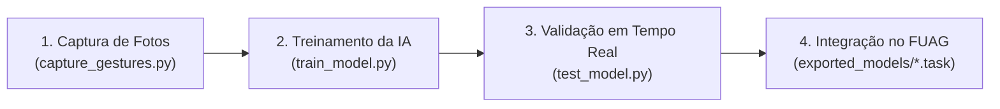

# 🖐️ IA_FUAG — Treinador de Movimentos e Gestos para o FUAG

[](https://www.python.org/)
[](https://developers.google.com/mediapipe)
[](https://www.tensorflow.org/)
[](https://github.com/vs1301210/FUAG)
[](LICENSE)

O **IA_FUAG** é o módulo complementar de Inteligência Artificial do ecossistema **FUAG (Ferramenta Universal de Acessibilidade em Games)**. Sua finalidade é permitir que qualquer usuário ou desenvolvedor **crie, treine e exporte novos movimentos e gestos manuais personalizados** para controlar jogos de PC, consoles ou dispositivos móveis sem encostar em botões físicos.

O pipeline utiliza o **Google MediaPipe Model Maker (Gesture Recognizer)** com extração de *Hand Landmarks* (21 pontos anatômicos tridimensionais), gerando modelos ultra-leves e otimizados com extensão `.task`, prontos para inferência em tempo real com latência próxima de zero.

---

## 🌟 Destaques do Projeto

- 🏷️ **Labels 100% Dinâmicas (Zero Presets):** Não há classes fixas no código. O nome de cada pasta que você criar dentro de `dataset/` torna-se automaticamente uma nova entrada de comando no modelo.
- ⚡ **Inferência em Edge Computing:** Gera arquivos `.task` compactos (menos de 10 MB), prontos para rodar em CPU local ou GPU móvel sem envio de dados para servidores ou internet.
- 🎯 **Imunidade a Fundo e Iluminação:** Como a IA treina sobre as coordenadas geométricas dos marcos anatômicos da mão (e não sobre os pixels brutos da imagem), o modelo é robusto a diferentes fundos, tons de pele e iluminações.
- 🛠️ **Suíte Completa:** Inclui scripts auxiliares para coleta de fotos com contagem e modo rajada (`capture_gestures.py`), treinamento automatizado (`train_model.py`) e teste em tempo real na webcam (`test_model.py`).

---

## 📁 Estrutura do Diretório

```text
IA_FUAG/
├── dataset/                      # Diretório dos dados de treino (uma subpasta por gesto)
│   ├── .gitkeep
│   ├── README.md                 # Guia anatômico e regras para as fotos
│   ├── none/                     # Classe de repouso (altamente recomendada)
│   ├── meu_gesto_a/              # Exemplos de gestos customizados
│   └── meu_gesto_b/
│
├── exported_models/              # Pasta de saída dos modelos compilados
│   ├── .gitkeep
│   ├── README.md
│   └── gesture_recognizer.task   # Modelo binário exportado (gerado pelo treino)
│
├── .vscode/
│   └── settings.json             # Apontamento do interpretador do VS Code
│
├── .gitignore                    # Filtro de arquivos locais, venv e temporários
├── requirements.txt              # Dependências oficiais (mediapipe, tensorflow, opencv)
├── capture_gestures.py           # Ferramenta para tirar fotos com a webcam
├── train_model.py                # Script principal de treinamento do MediaPipe
├── test_model.py                 # Validador do modelo .task na webcam em tempo real
│
├── setup.bat                     # Atalho Windows: Cria venv e instala dependências
├── capturar.bat                  # Atalho Windows: Executa o coletor de gestos
├── treinar.bat                   # Atalho Windows: Dispara o treinamento
└── testar.bat                    # Atalho Windows: Executa o validador em tempo real
```

---

## ⚙️ Pré-requisitos e Instalação

> [!IMPORTANT]
> **Versão do Python Necessária:** O pacote `mediapipe-model-maker` e as compilações do TensorFlow exigem **Python 3.9, 3.10 ou 3.11**. Versões como Python 3.12 ou 3.13 ainda não possuem suporte completo nas rodas binárias do TensorFlow para Windows.

### 1. Clonar o Repositório

```bash
git clone https://github.com/vs1301210/IA_FUAG.git
cd IA_FUAG
```

### 2. Configuração Rápida (Windows - Atalho de 1 Clique)

Dê um duplo clique no arquivo `setup.bat` ou execute no PowerShell:

```powershell
.\setup.bat
```

### 3. Configuração Manual no Terminal

Caso prefira configurar manualmente:

```powershell
# 1. Cria o ambiente virtual
python -m venv venv

# 2. Ativa o ambiente virtual no Windows PowerShell
.\venv\Scripts\Activate.ps1

# (Se houver bloqueio de script do PowerShell, execute antes:
#  Set-ExecutionPolicy -Scope Process -ExecutionPolicy Bypass)

# 3. Atualiza o pip e instala os requisitos
python -m pip install --upgrade pip
pip install -r requirements.txt
```

---

## 🚀 Como Usar a Ferramenta: Passo a Passo

O fluxo completo para adicionar novos movimentos divide-se em 3 etapas simples:



### Passo 1: Coleta das Fotos do Gesto

Você pode usar sua webcam com a ferramenta interativa `capture_gestures.py`:

```powershell
# Execução interativa:
python capture_gestures.py

# Ou informando o gesto diretamente:
python capture_gestures.py --label acelerar
```

**Comandos na janela de captura:**
- Pressione `[ESPAÇO]` para salvar 1 foto manual.
- Pressione `[B]` para ligar o **Modo Rajada** (captura fotos automáticas contínuas enquanto você move a mão suavemente).
- Pressione `[Q]` ou `[ESC]` para finalizar.

> [!TIP]
> **Recomendação de Dataset:**
> - Crie **sempre** a pasta `dataset/none/` contendo fotos da mão neutra, relaxada ou aberta sem intenção de comando. Isso ensina a IA a não disparar ações involuntárias.
> - Capture entre **30 e 100 fotos** para cada classe.
> - Varie distâncias da câmera (perto/longe), pequenas rotações e mãos diferentes (esquerda e direita).

### Passo 2: Executar o Treinamento

Com as fotos organizadas dentro das pastas em `dataset/`, execute:

```powershell
python train_model.py
# Ou clique duas vezes em treinar.bat
```

O script realizará automaticamente:
1. Verificação anatômica de landmarks de mãos.
2. Divisão dos dados (80% treino, 10% validação e 10% teste).
3. Treinamento do classificador por 10 épocas.
4. Avaliação de acurácia e perda (Loss).
5. Exportação automática do arquivo compilado para:
   `exported_models/gesture_recognizer.task`

### Passo 3: Testar o Modelo na Webcam

Antes de colocar o modelo no seu jogo, valide o reconhecimento em tempo real:

```powershell
python test_model.py
# Ou clique duas vezes em testar.bat
```

A câmera abrirá mostrando uma caixa superior com o **nome do gesto detectado** e a **porcentagem de confiança** instantânea!

---

## 🎮 Como Aplicar o Modelo dentro do FUAG

O **FUAG** consome modelos `.task` do MediaPipe Vision para converter percepção computacional em comandos físicos reais de controle (Xbox 360, PS4 ou Teclado/Mouse).

Abaixo estão as duas formas de integração:

### 1. Integração no FUAG Desktop (`pc_local_controller.py`)

No repositório do FUAG para computador, a ponte de visão computacional em Python processa o vídeo local e injeta os botões via **ViGEmBus** (`vgamepad`) ou eventos Win32.

#### A. Copiar o Modelo Compilado:
Copie o arquivo gerado:
`IA_FUAG/exported_models/gesture_recognizer.task`
Para a pasta raiz do FUAG:
`FUAG/gesture_recognizer.task`

#### B. Código de Exemplo para Reconhecimento e Mapeamento:

```python
import cv2
import mediapipe as mp
from mediapipe.tasks import python
from mediapipe.tasks.python import vision
import vgamepad as vg  # Driver ViGEmBus para emular Xbox 360 / PS4

# 1. Inicializa o controle virtual de Xbox 360
gamepad = vg.VX360Gamepad()

# 2. Carrega o modelo gerado pelo IA_FUAG
base_options = python.BaseOptions(model_asset_path="gesture_recognizer.task")
options = vision.GestureRecognizerOptions(
    base_options=base_options,
    running_mode=vision.RunningMode.IMAGE,
    num_hands=1
)
recognizer = vision.GestureRecognizer.create_from_options(options)

cap = cv2.VideoCapture(0)

while cap.isOpened():
    ret, frame = cap.read()
    if not ret:
        break

    # Converte imagem para formato do MediaPipe
    rgb_frame = cv2.cvtColor(frame, cv2.COLOR_BGR2RGB)
    mp_image = mp.Image(image_format=mp.ImageFormat.SRGB, data=rgb_frame)

    # Executa o reconhecimento
    result = recognizer.recognize(mp_image)

    if result.gestures:
        gesture_name = result.gestures[0][0].category_name
        score = result.gestures[0][0].score

        # Filtro de confiança mínima (evita falsos positivos)
        if score > 0.65:
            # 3. MAPEAMENTO DINÂMICO PARA OS BOTÕES DO FUAG
            if gesture_name == "acelerar":
                # Aciona o gatilho direito (RT) para acelerar no jogo
                gamepad.right_trigger_float(value_float=1.0)
                gamepad.update()
            elif gesture_name == "frear":
                # Aciona o gatilho esquerdo (LT) para frear
                gamepad.left_trigger_float(value_float=1.0)
                gamepad.update()
            elif gesture_name == "nitro":
                # Pressiona o botão 'A' (ou botão customizado)
                gamepad.press_button(button=vg.XUSB_BUTTON.XUSB_GAMEPAD_A)
                gamepad.update()
            elif gesture_name == "none":
                # Estado de repouso: solta os comandos
                gamepad.reset()
                gamepad.update()

    cv2.imshow("FUAG Controller", frame)
    if cv2.waitKey(1) & 0xFF == 27:
        break

cap.release()
cv2.destroyAllWindows()
```

---

### 2. Integração no FUAG Mobile (`mobile_controller` Flutter / Android)

Caso utilize o smartphone como controle remoto via Wi-Fi/USB:

1. Copie o `gesture_recognizer.task` para a pasta de assets:
   `FUAG/mobile_controller/assets/models/gesture_recognizer.task`
2. Certifique-se de que o arquivo está registrado no `pubspec.yaml`:
   ```yaml
   flutter:
     assets:
       - assets/models/gesture_recognizer.task
   ```
3. O pipeline C++ / Java nativo do MediaPipe Tasks carregará o asset e enviará o payload UDP dos gestos detectados diretamente para a `mobile_controller_bridge.py` no PC.

---

## 🎯 Dicas de Ouro para Acessibilidade Gamer no FUAG

1. **Evite Fadiga Muscular:** Para jogadores com limitações motoras, projete gestos que exijam pouco deslocamento físico (por exemplo, estender 1 dedo, fechar a mão ou rotação sutil de punho).
2. **Utilize Dwell Timers (Filtro Temporal):** No código do jogo, evite alternar ações instantaneamente a cada frame. Aguarde 2 a 3 frames consecutivos com a mesma classificação para confirmar o acionamento.
3. **Mantenha a Classe `none` Ampla:** Quanto mais fotos de posições neutras da mão estiverem em `none`, menos chances o modelo terá de disparar comandos acidentais durante pausas no jogo.

---

## 📄 Licença

Este projeto é distribuído sob a licença MIT como parte integrante e livre do ecossistema FUAG.
